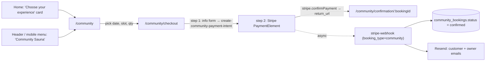
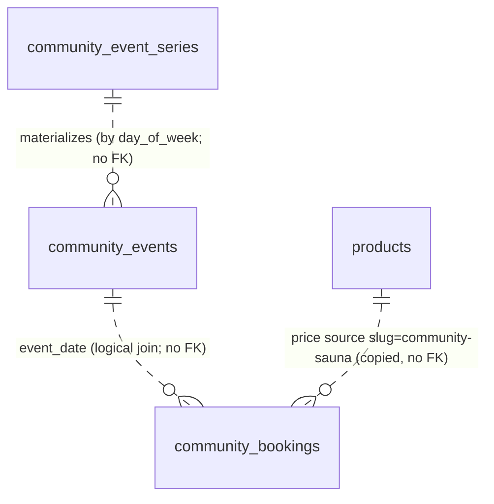

# Community Sauna — Re-implementation Guide

> **Status:** removed from the app. This document is the spec for adding it back.
> **Source of truth for the original code:** commit `3cdecf1` ("Added Community sauna service").
> The files are gone from the working tree, so view them with
> `git show 3cdecf1:<path>`, e.g. `git show 3cdecf1:src/lib/community.ts`.
> Every `path:line` reference below points at that commit (HEAD at time of writing). The relative links go to those historical paths and break once the files are deleted.
>
> **Placeholder:** the venue street address was hardcoded in about ten places. This document uses `<VENUE_ADDRESS>` instead. In the original design the address is admin-configurable per date (`community_events.location`) and per series (`community_event_series.location`). Hardcoded copies only served as UI fallbacks.

The private-rental product (`/book`, `bookings`, `create-payment-intent`) is unaffected by this feature. The home page and private booking flow are being redesigned. Treat sections 1, 3, 4 and 9 as **contracts** and section 6 as **reference styling**, not layout you must match.

---

## Table of contents

1. [Product overview and user-facing behaviour](#1-product-overview-and-user-facing-behaviour)
2. [Data model](#2-data-model)
3. [Business logic](#3-business-logic)
4. [Edge functions](#4-edge-functions)
5. [Admin functionality](#5-admin-functionality)
6. [UI and visual implementation](#6-ui-and-visual-implementation)
7. [Tests](#7-tests)
8. [Operational runbook](#8-operational-runbook)
9. [Re-implementation checklist, known issues and risks](#9-re-implementation-checklist-known-issues-and-risks)
10. [Removal record](#10-removal-record)

---

## 1. Product overview and user-facing behaviour

### 1.1 What it is

A **weekly drop-in sauna session** at a fixed venue. Customers buy **seats** in a **time slot**; they don't rent the whole sauna. The private rental is an exclusive, whole-day booking. The two products share almost nothing (see the table in [CLAUDE.md](../CLAUDE.md)).

| Aspect | Community Sauna |
|---|---|
| Unit sold | 1 seat = 1 person for one slot (default 60 min) |
| Default schedule | Thursdays 16:30–20:00, 60-min slots, 10 seats per slot ([012_community_events.sql](../supabase/migrations/012_community_events.sql), [CommunityEventsTab.tsx:30-40](../src/components/admin/CommunityEventsTab.tsx)) |
| Default slots generated | 16:30, 17:30, 18:30. A 19:30 slot is **not** created because it would end at 20:30, after `end_time` ([community.test.ts:123-126](../src/lib/__tests__/community.test.ts)) |
| Price | `products.base_price` where `slug = 'community-sauna'`, seeded at **$29.95/person** ([015_seed_community_product.sql](../supabase/migrations/015_seed_community_product.sql)) |
| Tax | 8.9% on the subtotal, rounded to the cent ([community.ts:4](../src/lib/community.ts), [create-community-payment-intent/index.ts:6](../supabase/functions/create-community-payment-intent/index.ts)) |
| Example totals | 1 seat: $29.95 + $2.67 = **$32.62**. 4 seats: $119.80 + $10.66 = **$130.46** ([community.test.ts:297-309](../src/lib/__tests__/community.test.ts)) |
| Same-day cutoff | A slot stays bookable until **slot start + 30 min** (inclusive). Example: the 17:00 slot can still be booked at 17:30 and closes at 17:31 ([community.test.ts:185-200](../src/lib/__tests__/community.test.ts)) |
| Timezone | The server evaluates "today/now" in `America/Los_Angeles` ([create-community-payment-intent/index.ts:36-52](../supabase/functions/create-community-payment-intent/index.ts)) |
| Capacity | `capacity_per_slot` per date. Every non-`cancelled` booking (including `pending`) counts against it |
| Max per reservation | The UI caps it at the seats left in the slot. The server rejects anything over capacity |
| Booking number | `SAU-C-YYYYMMDD-XXXX`. `YYYYMMDD` is the **event date**, not the purchase date. `XXXX` comes from `ABCDEFGHJKLMNPQRSTUVWXYZ23456789`, which has no 0/O/1/I ([community.ts:167-178](../src/lib/community.ts)). Private bookings use `SAU-YYYYMMDD-XXXX` |
| Payment | Stripe PaymentElement. The PaymentIntent is created server-side from server-computed numbers |
| Confirmation | The Stripe webhook flips `pending` to `confirmed` and sends a customer email and an owner email via Resend |
| Cancellation | Policy copy says "until 2 hours before arrival" ([CommunityCheckoutPage.tsx:221-223](../src/pages/CommunityCheckoutPage.tsx)). There is **no self-serve cancel or refund**. An admin cancels in the UI and refunds in the Stripe dashboard |

### 1.2 Customer funnel and routes



| Route | Page (default export, lazy-loaded in `App.tsx`) | Purpose |
|---|---|---|
| `/community` | `CommunitySaunaPage` | Calendar of active event dates, slot picker, quantity, subtotal, "Reserve My Seat" |
| `/community/checkout` | `CommunityCheckoutPage` | 3-step indicator. Customer info form, then PaymentElement. Sticky reservation summary |
| `/community/confirmation/:id` | `CommunityConfirmationPage` | `:id` = `community_bookings.id` (UUID). Shows details, an "Add to Calendar" `.ics` download, and "What to bring" |

Funnel state (date, slot, quantity) lives in a Zustand store in memory only. A hard refresh on `/community/checkout` loses it and redirects to `/community` ([CommunityCheckoutPage.tsx:380-386](../src/pages/CommunityCheckoutPage.tsx)).

### 1.3 Entry points that were wired in

From `git show 3cdecf1 -- <file>`:

- **Home:** `BookingOptionsSection` ("Two ways to sauna / Choose your experience") replaced `HowItWorksSection` + `FeaturedProductSection` on `HomePage`. `HowItWorksSection` moved to the top of `BookingPage`.
- **Hero:** the "Book Your Sauna" CTA was removed, and the outline button became "See Booking Options", which anchors to `#booking-options`. The hero also got shorter (`min-h-[clamp(440px,52svh,620px)]` instead of `min-h-svh`).
- **Header nav:** "Book Now" became "Private Sauna" (`/book`) plus "Community Sauna" (`/community`). The desktop "Book Now" button was removed.
- **Mobile menu:** two stacked buttons: "Private Sauna" (default) and "Community Sauna" (`variant="outline"`).
- **Cross-link:** at the bottom of `/community`: "Want the whole sauna to yourself? Book a Private Sauna Rental" links to `/book`.
- **Side effect:** the seed product has `type = 'standalone'`, so it also renders on `/products` under "Standalone Rentals". Its card has a "Book Now" link to `/book`, which is the wrong destination ([ProductsPage.tsx:109](../src/pages/ProductsPage.tsx), [ProductsPage.tsx:174](../src/pages/ProductsPage.tsx)).

---

## 2. Data model

### 2.1 Overview



- **`community_event_series`**: the recurring rule. The admin UI assumes a **single** series and reads the oldest by `created_at` with `limit(1)` ([CommunityEventsTab.tsx:89-94](../src/components/admin/CommunityEventsTab.tsx)). The edge function supports several.
- **`community_events`**: one row per concrete date (`event_date` UNIQUE). Public pages read **only** this table, filtered by `is_active = true`.
- **`community_bookings`**: one row per reservation. Many rows per `(event_date, slot_time)` are allowed while their `quantity` sum stays within capacity. Bookings join to events by `event_date` only.
- **Slot times are not stored.** They come from `start_time`, `end_time` and `slot_minutes` at read time (§3.3). `community_bookings.slot_time` stores the chosen arrival time as `HH:MM:00`.

### 2.2 `community_events` (migration 012)

```sql
CREATE TABLE community_events (
  id UUID PRIMARY KEY DEFAULT gen_random_uuid(),
  event_date DATE NOT NULL UNIQUE,
  start_time TIME NOT NULL DEFAULT '16:30',
  end_time TIME NOT NULL DEFAULT '20:00',
  slot_minutes INT NOT NULL DEFAULT 60,
  location TEXT NOT NULL DEFAULT '<VENUE_ADDRESS>',
  capacity_per_slot INT NOT NULL DEFAULT 10,
  is_active BOOLEAN NOT NULL DEFAULT true,
  created_at TIMESTAMPTZ NOT NULL DEFAULT now(),
  updated_at TIMESTAMPTZ NOT NULL DEFAULT now()
);

CREATE INDEX idx_community_events_date_active
  ON community_events (event_date)
  WHERE is_active = true;
```

### 2.3 `community_event_series` (migration 013)

```sql
CREATE TABLE community_event_series (
  id UUID PRIMARY KEY DEFAULT gen_random_uuid(),
  day_of_week INT NOT NULL CHECK (day_of_week BETWEEN 0 AND 6),  -- 0 = Sunday … 6 = Saturday (JS Date.getDay())
  start_time TIME NOT NULL DEFAULT '16:30',
  end_time TIME NOT NULL DEFAULT '20:00',
  slot_minutes INT NOT NULL DEFAULT 60,
  location TEXT NOT NULL DEFAULT '<VENUE_ADDRESS>',
  capacity_per_slot INT NOT NULL DEFAULT 10,
  starts_on DATE NOT NULL DEFAULT CURRENT_DATE,
  ends_on DATE,                                                 -- NULL = open-ended
  is_active BOOLEAN NOT NULL DEFAULT true,
  created_at TIMESTAMPTZ NOT NULL DEFAULT now(),
  updated_at TIMESTAMPTZ NOT NULL DEFAULT now()
);
```

### 2.4 `community_bookings` (migration 014)

```sql
CREATE TABLE community_bookings (
  id UUID PRIMARY KEY DEFAULT gen_random_uuid(),
  booking_number VARCHAR NOT NULL UNIQUE,
  event_date DATE NOT NULL,
  slot_time TIME NOT NULL,
  customer_name VARCHAR NOT NULL,
  customer_email VARCHAR NOT NULL,
  customer_phone VARCHAR,
  quantity INT NOT NULL DEFAULT 1 CHECK (quantity > 0),
  status TEXT NOT NULL CHECK (status IN ('pending', 'confirmed', 'cancelled', 'completed')) DEFAULT 'pending',
  subtotal DECIMAL(10, 2) NOT NULL,
  tax_amount DECIMAL(10, 2) NOT NULL,
  total_amount DECIMAL(10, 2) NOT NULL,
  stripe_payment_intent_id VARCHAR,
  notes TEXT,
  created_at TIMESTAMPTZ NOT NULL DEFAULT now(),
  updated_at TIMESTAMPTZ NOT NULL DEFAULT now()
);

CREATE INDEX idx_community_bookings_date_slot
  ON community_bookings (event_date, slot_time)
  WHERE status != 'cancelled';

CREATE INDEX idx_community_bookings_event_date
  ON community_bookings (event_date);
```

Status lifecycle:

| From | To | Trigger |
|---|---|---|
| (insert) | `pending` | `create-community-payment-intent` |
| `pending` | `confirmed` | webhook `payment_intent.succeeded` |
| `pending` | `cancelled` | webhook `payment_intent.payment_failed` (see risk R7), or admin "Cancel Booking" |
| `confirmed` | `completed` | admin "Mark Completed" |
| `confirmed` | `cancelled` | admin "Cancel Booking" (no automatic refund) |

### 2.5 Price row (migration 015)

```sql
INSERT INTO products (name, slug, description, type, base_price, is_active, sort_order)
VALUES (
  'Community Sauna Seat',
  'community-sauna',
  'A one-hour community sauna session at <VENUE_ADDRESS>. Bring your towel, robe, and water bottle.',
  'standalone',
  29.95,
  true,
  100
)
ON CONFLICT (slug) DO NOTHING;
```

`products.type` allows `'primary' | 'addon' | 'standalone'` ([001_create_products.sql](../supabase/migrations/001_create_products.sql)). The `slug` is the contract: client and server both look the product up by `slug = 'community-sauna'`. If you re-add the feature, consider a new type such as `'community'` so the row doesn't leak into `/products` (§1.3).

### 2.6 RLS (migration 016), as shipped

```sql
ALTER TABLE community_events ENABLE ROW LEVEL SECURITY;
ALTER TABLE community_event_series ENABLE ROW LEVEL SECURITY;
ALTER TABLE community_bookings ENABLE ROW LEVEL SECURITY;

-- community_events: public read active, authenticated full CRUD
CREATE POLICY "Public read active: community_events"
  ON community_events FOR SELECT TO anon, authenticated
  USING (is_active = true);

CREATE POLICY "Auth full access: community_events"
  ON community_events FOR ALL TO authenticated
  USING (true)
  WITH CHECK (true);

-- community_event_series: authenticated only
CREATE POLICY "Auth full access: community_event_series"
  ON community_event_series FOR ALL TO authenticated
  USING (true)
  WITH CHECK (true);

-- community_bookings: anon can read aggregate fields for capacity calc, authenticated full CRUD
CREATE POLICY "Anon read availability: community_bookings"   -- ⚠ INSECURE, see §9.3
  ON community_bookings FOR SELECT TO anon
  USING (true);

CREATE POLICY "Auth full access: community_bookings"
  ON community_bookings FOR ALL TO authenticated
  USING (true)
  WITH CHECK (true);
```

> ⚠ The comment says "aggregate fields", but RLS filters **rows**, not columns. `USING (true)` lets anyone holding the public anon key (it ships in the JS bundle) run `select * from community_bookings` and read **every customer's name, email, phone and notes** ([016_community_rls.sql:22-25](../supabase/migrations/016_community_rls.sql)). Supabase documents RLS as row-level, and column restrictions need column privileges ([Supabase: Column Level Security](https://supabase.com/docs/guides/database/postgres/column-level-security)). The re-implementation **must** expose only aggregate seat counts. §9.3 has the replacement SQL.

Write paths: the public never writes. Bookings are inserted and updated only by edge functions running with the service-role key, which bypasses RLS. Any authenticated user is an admin, because there is no role check in `ProtectedRoute` ([CLAUDE.md](../CLAUDE.md)).

### 2.7 Series → materialized dates

- The admin edits the series once, then clicks **"Regenerate next 12 weeks"**.
- For each day in `[today, today + 84 days)` where `getDay() === day_of_week`, `starts_on <= date`, and (`ends_on` is null or `date <= ends_on`), a row is upserted into `community_events` with `onConflict: 'event_date', ignoreDuplicates: true` ([CommunityEventsTab.tsx:164-192](../src/components/admin/CommunityEventsTab.tsx)).
- `ignoreDuplicates` is the important part. **Existing dates are never overwritten**, so per-date edits (different hours, deactivation) survive regeneration. The flip side is that **editing the series doesn't change dates already generated**. To apply a series change to existing dates, edit them individually, or delete them and regenerate.
- A **deleted** date inside the series window comes back on the next regenerate. To cancel a date durably, toggle it off; don't delete it.
- Nothing runs on a schedule. Dates run out after 12 weeks unless someone clicks Regenerate. The `expand-community-series` edge function (§4.3) could be put on a cron, but it wasn't.

### 2.8 Types (`src/types/index.ts`)

```ts
export interface CommunityEvent {
  id: string;
  event_date: string;        // 'YYYY-MM-DD'
  start_time: string;        // 'HH:MM:SS' from Postgres (UI forms send 'HH:MM')
  end_time: string;
  slot_minutes: number;
  location: string;
  capacity_per_slot: number;
  is_active: boolean;
  created_at: string;
  updated_at: string;
}

export interface CommunityEventSeries {
  id: string;
  day_of_week: number;       // 0–6, Sunday = 0
  start_time: string;
  end_time: string;
  slot_minutes: number;
  location: string;
  capacity_per_slot: number;
  starts_on: string;
  ends_on: string | null;
  is_active: boolean;
  created_at: string;
  updated_at: string;
}

export interface CommunityBooking {
  id: string;
  booking_number: string;
  event_date: string;
  slot_time: string;
  customer_name: string;
  customer_email: string;
  customer_phone: string | null;
  quantity: number;
  status: 'pending' | 'confirmed' | 'cancelled' | 'completed';
  subtotal: number;
  tax_amount: number;
  total_amount: number;
  stripe_payment_intent_id: string | null;
  notes: string | null;
  created_at: string;
  updated_at: string;
}
```

---

## 3. Business logic

All pure helpers lived in [`src/lib/community.ts`](../src/lib/community.ts). Several of them were **tested but not used**: the pages, the admin view and the edge function inlined their own copies (§3.9, risk R13). On re-implementation, import the helpers everywhere on the client and keep exactly one server copy.

### 3.1 Constants

```ts
export const COMMUNITY_CUTOFF_MINUTES = 30   // same-day booking allowed until slot start + 30 min
export const COMMUNITY_TAX_RATE = 0.089      // 8.9%
const COMMUNITY_PRICE_FALLBACK = 29.95       // display-only fallback while products load
```

### 3.2 Date and time helpers

These follow the repo's date conventions in [CLAUDE.md](../CLAUDE.md#dates-and-times): timezone-naive `YYYY-MM-DD` strings, `HH:MM:SS` times, no `toISOString()`.

```ts
/** Local calendar fields → 'YYYY-MM-DD' (never toISOString(), which shifts the day). */
export function formatDateToISO(date: Date): string {
  const y = date.getFullYear()
  const m = String(date.getMonth() + 1).padStart(2, '0')
  const d = String(date.getDate()).padStart(2, '0')
  return `${y}-${m}-${d}`
}

/** 'HH:MM' | 'HH:MM:SS' → '5:00 PM' */
export function formatTime(time: string): string {
  const [h, m] = time.slice(0, 5).split(':').map(Number)
  const period = h >= 12 ? 'PM' : 'AM'
  const hour = h % 12 || 12
  return `${hour}:${String(m).padStart(2, '0')} ${period}`
}

/** 'YYYY-MM-DD' → 'Thursday, April 23, 2026' (parse at local noon to avoid day drift). */
export function formatDisplayDate(dateStr: string): string {
  return new Date(dateStr + 'T12:00:00').toLocaleDateString('en-US', {
    weekday: 'long', month: 'long', day: 'numeric', year: 'numeric',
  })
}

/** Canonical 'HH:MM:00' — use before comparing slot times or keying maps. '9:00' → '09:00:00'. */
export function normalizeTime(time: string): string {
  const [h, m] = time.slice(0, 5).split(':').map(Number)
  return `${String(h).padStart(2, '0')}:${String(m).padStart(2, '0')}:00`
}
```

### 3.3 Slot generation (slot times are derived, never stored)

```ts
export function generateSlotTimes(
  event: Pick<CommunityEvent, 'start_time' | 'end_time' | 'slot_minutes'>,
): string[] {
  const [sh, sm] = event.start_time.slice(0, 5).split(':').map(Number)
  const [eh, em] = event.end_time.slice(0, 5).split(':').map(Number)
  const startMin = sh * 60 + sm
  const endMin = eh * 60 + em
  const slots: string[] = []
  if (event.slot_minutes <= 0) return slots              // guard: prevents an infinite loop
  for (let t = startMin; t + event.slot_minutes <= endMin; t += event.slot_minutes) {
    const h = Math.floor(t / 60)
    const m = t % 60
    slots.push(`${String(h).padStart(2, '0')}:${String(m).padStart(2, '0')}:00`)
  }
  return slots
}
```

Rule: a slot is emitted only if a **full** `slot_minutes` window fits before `end_time`. `end_time` is effectively "the sauna closes", not "last arrival".

| start–end | slot_minutes | Slots |
|---|---|---|
| 16:30–20:00 | 60 | 16:30, 17:30, 18:30 |
| 17:00–19:00 | 30 | 17:00, 17:30, 18:00, 18:30 |
| 17:00–20:00 | 90 | 17:00, 18:30 |
| 17:00–18:45 | 60 | 17:00 |
| 18:00–18:00 | 60 | (none) |
| any | 0 | (none) |

Server-side slot legality uses the same arithmetic ([community.ts:147-161](../src/lib/community.ts), mirrored in [create-community-payment-intent/index.ts:103-122](../supabase/functions/create-community-payment-intent/index.ts)):

```ts
export function isSlotInWindow(event, slotTime): boolean {
  // startMin <= slotMin, slotMin + slot_minutes <= endMin, (slotMin - startMin) % slot_minutes === 0
}
```

### 3.4 Cutoff and timezone

Client ([community.ts:79-92](../src/lib/community.ts)):

```ts
export function isSlotPast(eventDate: string, slotTime: string, now: Date = new Date()): boolean {
  const todayStr = formatDateToISO(now)
  if (eventDate < todayStr) return true
  if (eventDate > todayStr) return false
  const [h, m] = slotTime.slice(0, 5).split(':').map(Number)
  const cutoffMinutes = h * 60 + m + COMMUNITY_CUTOFF_MINUTES
  const nowMinutes = now.getHours() * 60 + now.getMinutes()
  return nowMinutes > cutoffMinutes                       // bookable AT exactly +30, closed at +31
}
```

Server ([create-community-payment-intent/index.ts:36-52, 124-137](../supabase/functions/create-community-payment-intent/index.ts)):

```ts
function getSpokaneTime(): { dateStr: string; minutes: number } {
  const parts = new Intl.DateTimeFormat('en-US', {
    timeZone: 'America/Los_Angeles',
    year: 'numeric', month: '2-digit', day: '2-digit',
    hour: '2-digit', minute: '2-digit', hour12: false,
  }).formatToParts(new Date())
  const get = (t: string) => parts.find((p) => p.type === t)?.value ?? '0'
  return {
    dateStr: `${get('year')}-${get('month')}-${get('day')}`,
    minutes: Number(get('hour')) * 60 + Number(get('minute')),
  }
}
// reject if event_date < today (409 'This event has already passed')
// reject if event_date === today && slotMin + 30 < nowMinutes (409 'Booking window for this slot has closed')
```

Both sides agree on the boundary (still bookable at exactly +30). The client, however, uses the **browser's** local clock while the server uses Los Angeles time (risk R10). On re-implementation, compute "now" in `America/Los_Angeles` on the client too, using the same `Intl.DateTimeFormat` trick. With `hour12: false`, some engines format midnight as `"24"`. `hourCycle: 'h23'` avoids that ([MDN: Intl.DateTimeFormat hourCycle](https://developer.mozilla.org/en-US/docs/Web/JavaScript/Reference/Global_Objects/Intl/DateTimeFormat/DateTimeFormat#hourcycle)).

### 3.5 Availability aggregation

Read hook ([useCommunityAvailability.ts](../src/hooks/useCommunityAvailability.ts)). It read **raw booking rows** as anon, which is why the insecure RLS policy existed:

```ts
export interface CommunitySlotCount { event_date: string; slot_time: string; booked_quantity: number }

export function useCommunityAvailability(eventDate: string | null) {
  return useQuery<CommunitySlotCount[]>({
    queryKey: ['community-availability', eventDate],
    queryFn: async () => {
      if (!eventDate) return []
      const { data, error } = await supabase
        .from('community_bookings')
        .select('event_date, slot_time, quantity, status')
        .eq('event_date', eventDate)
        .neq('status', 'cancelled')                    // pending + confirmed + completed all count
      if (error) throw error
      // group by `${event_date}|${slot_time.slice(0, 8)}` and sum quantity
      ...
    },
    enabled: !!eventDate,
  })
}
```

Pure equivalents (tested):

```ts
/** Sum quantity per normalized slot time, ignoring cancelled. */
export function aggregateBookedBySlot(
  bookings: ReadonlyArray<{ slot_time: string; quantity: number; status: string }>,
): Map<string, number>

export interface SlotAvailability {
  slotTime: string; booked: number; remaining: number; capacity: number; past: boolean; full: boolean
}

/** One entry per generated slot: remaining = max(0, capacity - booked); full = remaining === 0. */
export function getSlotAvailability(
  event: CommunityEvent, bookedBySlot: Map<string, number>, now: Date = new Date(),
): SlotAvailability[]
```

A slot is **selectable** when `!full && !past`. The quantity stepper max is `remaining` ([CommunitySaunaPage.tsx:203-209](../src/pages/CommunitySaunaPage.tsx)).

**Re-implementation contract:** replace the raw-row query with an RPC that returns `(slot_time, booked_quantity)` only (§9.3). Keep the key normalization (`normalizeTime`), because Postgres returns `HH:MM:SS` and forms send `HH:MM`.

### 3.6 Pricing and tax

```ts
export function calculateCommunityPricing(
  unitPrice: number, quantity: number, taxRate: number = COMMUNITY_TAX_RATE,
): { subtotal: number; tax: number; total: number } {
  const subtotal = Math.round(unitPrice * quantity * 100) / 100
  const tax = Math.round(subtotal * taxRate * 100) / 100
  const total = Math.round((subtotal + tax) * 100) / 100
  return { subtotal, tax, total }
}
// Stripe amount = Math.round(total * 100) cents
```

Rounding order matters for parity: round the subtotal, then the tax on the rounded subtotal, then the total. There are no coupons, add-ons, or pricing rules for community seats.

### 3.7 Booking number

```ts
export function generateCommunityBookingNumber(eventDate: string, random: () => number = Math.random): string {
  const dateCompact = eventDate.replace(/-/g, '')
  const chars = 'ABCDEFGHJKLMNPQRSTUVWXYZ23456789'   // 32 chars, no 0/O/1/I
  let suffix = ''
  for (let i = 0; i < 4; i++) suffix += chars[Math.floor(random() * chars.length)]
  return `SAU-C-${dateCompact}-${suffix}`
}
```

32⁴ ≈ 1.05M combinations per event date. `booking_number` is UNIQUE, so a collision makes the insert fail. The original code had no retry (risk R12).

### 3.8 Client/server duplication contract

The client computes prices **for display only**. The edge function re-fetches the event and the product, then re-derives everything. **Change both sides together.**

| Rule | Client location (3cdecf1) | Server location (3cdecf1) |
|---|---|---|
| Tax rate 8.9% | `COMMUNITY_TAX_RATE` [community.ts:4](../src/lib/community.ts); **also** a local `TAX_RATE` in [CommunityCheckoutPage.tsx:44](../src/pages/CommunityCheckoutPage.tsx) | [create-community-payment-intent/index.ts:6](../supabase/functions/create-community-payment-intent/index.ts) |
| Cutoff 30 min | `COMMUNITY_CUTOFF_MINUTES` [community.ts:3](../src/lib/community.ts) | `CUTOFF_MINUTES` [index.ts:7](../supabase/functions/create-community-payment-intent/index.ts) |
| Rounding | `calculateCommunityPricing`; inlined copy at [CommunityCheckoutPage.tsx:373-378](../src/pages/CommunityCheckoutPage.tsx) | [index.ts:178-182](../supabase/functions/create-community-payment-intent/index.ts) |
| Slot generation / window | `generateSlotTimes`, `isSlotInWindow`; inlined copy (without the 0 guard) in [CommunityBookingsView.tsx:54-66](../src/components/admin/CommunityBookingsView.tsx) | [index.ts:103-122](../supabase/functions/create-community-payment-intent/index.ts) |
| Capacity counts non-cancelled | `.neq('status','cancelled')` in the hook | [index.ts:140-150](../supabase/functions/create-community-payment-intent/index.ts) |
| Booking number format | `generateCommunityBookingNumber` (tests only) | `generateBookingNumber` [index.ts:21-29](../supabase/functions/create-community-payment-intent/index.ts) |
| Price source | `products.slug = 'community-sauna'`, fallback 29.95 | same slug; **no fallback**, returns 500 if missing or inactive |

The 8.9% rate was one of the "five places" in [CLAUDE.md](../CLAUDE.md). Two of those five were community files, and the checkout page had a third, undocumented copy. On re-add, put the server constants in `supabase/functions/_shared/` and import them from both edge functions.

### 3.9 Funnel state (Zustand)

```ts
// src/stores/communityBookingStore.ts
interface CommunityBookingState {
  selectedEventDate: string | null   // 'YYYY-MM-DD'
  selectedSlotTime: string | null    // 'HH:MM:00'
  quantity: number                   // >= 1
  setSelectedEventDate: (date: string | null) => void   // ALSO clears selectedSlotTime
  setSelectedSlotTime: (time: string | null) => void
  setQuantity: (qty: number) => void                    // clamps to Math.max(1, qty); no upper clamp
  reset: () => void                                     // called on confirmation page mount
}
```

Only ephemeral selection lives here. Server data stays in TanStack Query (repo convention). The page enforces the upper bound with an effect.

### 3.10 Read hooks

```ts
// src/hooks/useCommunityEvents.ts
useCommunityEvents()      // queryKey ['community-events']: active events with event_date >= today, ascending
useNextCommunityEvent()   // queryKey ['community-events','next']: first of the above (limit 1, maybeSingle)
```

⚠ Both computed `today` with `new Date().toISOString().split('T')[0]`, which is the **UTC** date ([useCommunityEvents.ts:9, 27](../src/hooks/useCommunityEvents.ts)). On a Pacific-time evening, after 17:00 PDT or 16:00 PST, today's event drops out of the list while its later slots are still bookable (risk R9). Use the LA-local date instead.

---

## 4. Edge functions

All three use `corsHeaders` from `supabase/functions/_shared/cors.ts` (`Access-Control-Allow-Origin: *`) and the service-role client. Environment variable **names** (set values with `supabase secrets set`; never commit them): `SUPABASE_URL`, `SUPABASE_SERVICE_ROLE_KEY`, `STRIPE_SECRET_KEY`, `STRIPE_WEBHOOK_SECRET`, `RESEND_API_KEY`, `FROM_EMAIL`, `OWNER_EMAIL`. The client uses `VITE_STRIPE_PUBLISHABLE_KEY`.

### 4.1 `create-community-payment-intent`

**Request:** `POST`, invoked via `supabase.functions.invoke('create-community-payment-intent', { body })`.

```ts
interface CommunityPaymentIntentRequest {
  event_date: string          // 'YYYY-MM-DD'
  slot_time: string           // 'HH:MM' or 'HH:MM:SS'; server normalizes to 'HH:MM:00'
  quantity: number            // integer >= 1
  customer: { name: string; email: string; phone: string; notes?: string }
}
```

The body carries **no money fields**. That's the point.

**Success response (200):**

```ts
interface PaymentIntentResponse { clientSecret: string; bookingId: string; bookingNumber: string }
```

**Validation pipeline, in order** ([index.ts:63-227](../supabase/functions/create-community-payment-intent/index.ts)):

| # | Check | Failure status | `error` message |
|---|---|---|---|
| 1 | `event_date`, `slot_time`, `quantity >= 1`, `customer.name`, `customer.email` present | 400 | `Missing required fields` |
| 2 | `community_events` row for `event_date` with `is_active = true` | 409 | `No active Community Sauna on this date` |
| 3 | `start <= slot`, `slot + slot_minutes <= end` | 400 | `Invalid arrival time for this event` |
| 4 | `(slot - start) % slot_minutes === 0` | 400 | `Invalid arrival time for this event` |
| 5 | `event_date >= today (LA)` | 409 | `This event has already passed` |
| 6 | If today: `slot + 30 >= nowMinutes (LA)` | 409 | `Booking window for this slot has closed` |
| 7 | `sum(quantity where status != 'cancelled') + quantity <= capacity_per_slot` | 409 | `Only N seat(s) remaining in this time slot` |
| 8 | `products` row `slug='community-sauna'` exists and `is_active` | 500 | `Community Sauna product is not configured` |
| 9 | Compute subtotal/tax/total server-side, `amount = round(total*100)` | | |
| 10 | `stripe.paymentIntents.create({ amount, currency: 'usd', metadata })` | 500 | `Internal server error` (catch-all) |
| 11 | Insert the `community_bookings` row as `pending` with `stripe_payment_intent_id` | 500 | `Failed to create booking` |

**Stripe metadata** (strings only). The webhook branches on `booking_type`:

```ts
metadata: {
  booking_type: 'community',      // REQUIRED: anything else is routed to the private handler
  booking_number: bookingNumber,
  event_date,
  slot_time: normalizedSlot,      // 'HH:MM:00'
  quantity: String(quantity),
  customer_email: customer.email, // consider dropping: the booking row already has it
}
```

Stripe API version pinned: `2023-10-16`. Imports: `https://deno.land/std@0.177.0/http/server.ts`, `https://esm.sh/@supabase/supabase-js@2`, `https://esm.sh/stripe@14?target=deno`.

**Known gaps in this function** (details in §9.2): the capacity check and insert are not atomic (R2); the PaymentIntent is created before the row, so a failed insert orphans a PI (R12); pending rows never expire and anyone can create them (R3); `quantity` isn't checked to be an integer; phone isn't required server-side even though the form requires it.

### 4.2 Client wrapper (`src/lib/stripe.ts`)

```ts
export async function createCommunityPaymentIntent(
  data: CommunityPaymentIntentRequest,
): Promise<PaymentIntentResponse> {
  const { data: result, error } = await supabase.functions.invoke('create-community-payment-intent', { body: data })
  if (error) throw error
  if (result?.error) throw new Error(result.error)
  return result as PaymentIntentResponse
}
```

⚠ For non-2xx responses, supabase-js returns a `FunctionsHttpError` whose message is the generic "Edge Function returned a non-2xx status code". The server's message sits in `await error.context.json()` ([Supabase docs: functions.invoke, error handling](https://supabase.com/docs/reference/javascript/functions-invoke)). So the friendly 409 messages above ("Only 2 seat(s) remaining…") never reached the toast ([stripe.ts:63](../src/lib/stripe.ts)). Fix this on re-add by unwrapping `error.context`.

### 4.3 `expand-community-series`

Materializes series into dates server-side. **The admin UI never called it.** The "Regenerate" button did the same loop in the browser (§5.1).

- **Request:** `POST { series_id?: string; weeks?: number }`. `weeks` defaults to 12 and is clamped to `[1, 52]`. Any other method uses defaults.
- **Behaviour:** loads `community_event_series` where `is_active = true` (optionally one `id`). For each day in `[today, today + weeks*7)` it matches `day_of_week` and the `starts_on`/`ends_on` bounds, then upserts into `community_events` with `onConflict: 'event_date', ignoreDuplicates: true, count: 'exact'`.
- **Responses:** `200 { inserted, generated }`, `200 { inserted: 0, message: 'No active series' | 'No dates to generate' }`, `500 { error }`.
- ⚠ **No auth check.** It runs with the service role, and nothing in the repo turns off JWT verification for it (only `stripe-webhook/config.toml` sets `verify_jwt = false`). With default gateway JWT verification, the public anon key is enough to call it ([Supabase: Function configuration](https://supabase.com/docs/guides/functions/function-configuration)). The impact is limited because it's idempotent and only reads active series, but add an admin check (verify the caller's JWT with `supabase.auth.getUser()`) or run it from `pg_cron` only.
- `today` here is the **UTC** midnight of the Deno runtime ([expand-community-series/index.ts:48-49](../supabase/functions/expand-community-series/index.ts)).

Differences from the in-browser regenerate:

| | Admin button | Edge function |
|---|---|---|
| Series considered | first series, even if inactive | all **active** series |
| `is_active` on new rows | copied from series | always `true` (only active series are expanded) |
| "Today" | browser local | UTC |

### 4.4 `stripe-webhook` (shared with private rentals)

`supabase/functions/stripe-webhook/config.toml` sets `verify_jwt = false`. Stripe calls the function directly and the signature is verified with `stripe.webhooks.constructEventAsync(body, sig, STRIPE_WEBHOOK_SECRET, undefined, Stripe.createSubtleCryptoProvider())`.

Branching ([stripe-webhook/index.ts:301-323](../supabase/functions/stripe-webhook/index.ts)):

```ts
if (event.type === 'payment_intent.succeeded') {
  const pi = event.data.object as Stripe.PaymentIntent
  if (pi.metadata?.booking_type === 'community') await handleCommunitySuccess(supabase, pi)
  else await handlePrivateSuccess(supabase, pi)
} else if (event.type === 'payment_intent.payment_failed') {
  const pi = event.data.object as Stripe.PaymentIntent
  const table = pi.metadata?.booking_type === 'community' ? 'community_bookings' : 'bookings'
  await supabase.from(table)
    .update({ status: 'cancelled', updated_at: new Date().toISOString() })
    .eq('stripe_payment_intent_id', pi.id)
}
// always 200 { received: true }; 400 only for a bad signature; handler exceptions also return 200
```

`handleCommunitySuccess` ([index.ts:153-267](../supabase/functions/stripe-webhook/index.ts)):

1. `update community_bookings set status='confirmed' where stripe_payment_intent_id = pi.id` returning `*` (`.single()`). On error it logs and returns.
2. Loads `community_events` for `booking.event_date` to get `location`, falling back to the hardcoded venue address.
3. Sends the **customer email** via Resend (`from: FROM_EMAIL` with a hardcoded fallback sender):
   - Subject: `Community Sauna Reservation Confirmed — {booking_number}`
   - H1 (brand brown `#5C3D2E`): "Your Community Sauna seat is reserved!"
   - Details box (`background:#f9f6f3`): Booking Number, Date (long format), Arrival Time (12h), Guests, Location, Notes (if any)
   - Totals table: Subtotal, Tax, **Total Paid**
   - "What to bring": towel and robe; change of clothes and sandals; water bottle; arrive 10 minutes before your time slot
   - "Cancellation Policy": "Please cancel at least 2 hours before your arrival time so we can free up the seat for someone else."
   - Footer: "Questions? Reply to this email. See you at the sauna!"
4. If `OWNER_EMAIL` is set, sends the **owner email**:
   - Subject: `New Community Booking — {booking_number} ({quantity}× at {h:mm AM})`
   - H1: "New Community Sauna Reservation". Box: booking number, customer name, email, phone, date, arrival, guests, notes. Bold total.
5. Email errors are caught and logged, and never fail the webhook.

Gaps (§9.2): no idempotency or status guard (R8), cancelling on `payment_failed` (R7), unescaped HTML interpolation (R11), no check that the amount matches.

---

## 5. Admin functionality

Admin routes: `/admin` (dashboard), `/admin/bookings`, `/admin/settings`, behind `ProtectedRoute` + `AdminLayout`. All admin reads and writes use the **anon client with an authenticated session**, so they rely on the `Auth full access` RLS policies.

### 5.1 Settings → "Community Events" tab (`CommunityEventsTab`)

Registered as the second tab in `AdminSettingsPage`: `Calendar | Community Events | Products | Pricing Rules` (`<TabsTrigger value="community">`).

**Layout:** `grid gap-6 lg:grid-cols-[420px_1fr]`, with the form card on the left and the list card on the right (stacked on mobile). Skeleton: two blocks, `h-64` and `h-48`.

**Left card: "Recurring Schedule"** (`Card` / `CardHeader` / `CardTitle className="text-base"`):

| Field | Control | Default (new series) |
|---|---|---|
| Day of week | `Select` (Sunday…Saturday, value = index) | Thursday (4) |
| Start time / End time | two `Input type="time"` in `grid grid-cols-2 gap-3` | 16:30 / 20:00 |
| Slot length (min) | `Select`: 30 / 60 / 90 | 60 |
| Capacity / slot | `Input type="number" min=1` (`Number(v) \|\| 1`) | 10 |
| Location | `Input` | `<VENUE_ADDRESS>` |
| Starts on / Ends on (optional) | two `Input type="date"`. An empty end date is stored as `null` | today (computed with `toISOString`, UTC, see R9) / empty |
| Active | `Switch` + `Label` | on |

Buttons (`flex flex-col gap-2 pt-2`):

- Primary **"Create Schedule"**, or **"Update Schedule"** once a series exists ("Saving…" while busy). It inserts or updates `community_event_series` and toasts "Recurring schedule saved" (sonner).
- Outline **"Regenerate next 12 weeks"** with a `RefreshCw` icon ("Generating…" while busy), disabled until a series exists. It loops 84 days from local midnight, builds rows, upserts with `ignoreDuplicates`, toasts `Generated N upcoming events` (N counts rows *attempted*, not inserted), then refetches.

**Right card: "Upcoming Community Events".** It lists `community_events` with `event_date >= today` (all, including inactive), ascending. Empty state: "No upcoming events. Save a recurring schedule and click "Regenerate" to populate."

Row: `flex items-center justify-between rounded-lg border px-3 py-2`.

- Left: date as `Thu, Apr 23, 2026` (`text-sm font-medium`) + `Badge` **Active** (`variant="default"`) / **Off** (`variant="secondary"`). Second line `text-xs text-muted-foreground`: `4:30 PM – 8:00 PM · 60-min slots · 10/slot`.
- Right: `Switch` (toggles `is_active` immediately), ghost `icon-sm` `Pencil` button (opens the edit dialog), ghost `icon-sm` `Trash2` button (`text-destructive`). Delete asks `confirm('Delete this event? Existing bookings will remain but the date will no longer be bookable.')` and hard-deletes the row.

**Edit dialog** (`Dialog`, title `Edit Event – Thu, Apr 23, 2026`): start/end time, slot length select, capacity, location, Active switch. Footer: outline **Cancel** and **Save**. It updates that row only and toasts "Event updated".

⚠ Editing `start_time` or `slot_minutes` on a date that already has bookings can move existing bookings off the generated slot grid. They then disappear from availability counts and from the admin roster (R14). Block such edits when bookings exist, or show orphaned slots.

### 5.2 Bookings → "Community Sauna" tab (`CommunityBookingsView`)

`AdminBookingsPage` became a `Tabs` shell: **Private Rentals** (`PrivateBookingsView`, the old page body extracted in the same commit) | **Community Sauna**.

**Data:** all `community_events` (ascending) and all `community_bookings` (by `event_date`, then `slot_time`). There is no date window and no pagination, so it hits PostgREST's default row cap once data grows.

**Toolbar:** a right-aligned status `Select` (`w-[180px]`): All Statuses / Pending / Confirmed / Completed / Cancelled.

**Body:** one `Card` per date. Dates come from the union of bookings and events, sorted ascending.

- **Header**, left: `CardTitle text-lg` with the long date. Below it in `text-xs text-muted-foreground`: `Clock` + hours, `MapPin` + location, and a secondary `Badge` "Event off" if inactive. If no event row exists: "Event no longer scheduled".
- **Header**, right: "TOTAL BOOKINGS" (`text-xs uppercase tracking-wider`), then the seat sum of non-cancelled bookings (`text-2xl font-bold`), then `$X revenue`, summing `total_amount` of confirmed + completed. It's hidden when 0.
- **Content:** one block per generated slot (`rounded-lg border bg-muted/20 p-3`). If the event is gone, it falls back to distinct booked slot times.
  - Slot header: time (`font-medium text-sm`), an outline `Badge` with `Users` icon `booked/capacity`, a secondary `Badge` "Full" when no seats remain, and on the right `N seats left`.
  - Roster: one `button` per non-cancelled booking (`hover:bg-background`): customer name (truncate), `× qty` if > 1, a status `Badge` coloured by status, and the booking number in `font-mono text-xs`. If empty: italic "No bookings yet".

Status badge colours:

```ts
const statusColors = {
  pending:   'bg-yellow-100 text-yellow-800',
  confirmed: 'bg-green-100 text-green-800',
  completed: 'bg-blue-100 text-blue-800',
  cancelled: 'bg-red-100 text-red-800',
}
```

**Detail `Sheet`** (opens on row click). Title "Booking {booking_number}", description "Created {locale datetime}". Sections separated by `Separator`: Status badge; Customer (name, `Mail` email, `Phone` phone); Event (long date; `Arrival: 5:30 PM · 2 people`); Notes; Subtotal / Tax / **Total**. Actions:

- **Mark Completed**, shown when `confirmed`.
- **Cancel Booking** (`variant="destructive"`), shown when `pending` or `confirmed`.

Both update `status` + `updated_at` and patch local state optimistically. Errors are ignored (R15). There is no refund integration: refund in the Stripe dashboard.

⚠ The per-slot roster always filters out `cancelled`, so the **Cancelled** filter shows date cards with empty rosters (R16). The inlined slot generator has no `slot_minutes <= 0` guard, so a row with `slot_minutes = 0` **hangs the tab in an infinite loop** ([CommunityBookingsView.tsx:60](../src/components/admin/CommunityBookingsView.tsx), R5).

### 5.3 Dashboard stat

`AdminDashboard` gained a fifth card, and the grid went from `lg:grid-cols-4` to `lg:grid-cols-5`:

```ts
{ title: 'Community (7 days)', value: stats?.communityThisWeek ?? 0, icon: Users, format: (v) => String(v) }
// value = sum(quantity) from community_bookings
//   where event_date between today and today+7 (both via toISOString(): UTC dates)
//   and status in ('confirmed', 'pending')
```

It counts **seats**, not bookings, and includes unpaid `pending` rows. Consider confirmed + completed only, with LA-local dates.

---

## 6. UI and visual implementation

### 6.1 Design language: how "community" was distinguished

Theme tokens ([src/index.css:27-48](../src/index.css), Tailwind v4 CSS-first, no `tailwind.config`):

| Token | Value | Role in this feature |
|---|---|---|
| `--primary` | `#5C3D2E` (dark wood brown) | Prices, selected states, primary CTAs, step indicator, Stripe `colorPrimary` |
| `--accent` | `#D4A03C` (amber/gold) | **Community identity**: highlighted calendar days, event dot, "How it works" icons, card border, badge, community CTA background |
| `--accent-foreground` | `#2C2C2C` | Text on accent |
| `--secondary` | `#8FA98B` (sage) | Private card feature icons (contrast with the community accent icons) |
| `--muted` / `--muted-foreground` | `#F0EDE8` / `#6B6360` | Info boxes (`bg-muted/30`, `bg-muted/40`), helper text |
| `--border` | `#E5DDD5` | Cards, dashed empty state |
| `--radius` | `0.625rem` | `rounded-lg` everywhere |

Rule of thumb in the original: **accent marks "this is a community thing", primary marks "this is selected / this is money / do this next".** Prices stayed `text-primary` even on community cards.

Libraries: shadcn/Radix components from `src/components/ui/` (`Button`, `Card`, `Badge`, `Skeleton`, `Separator`, `Input`, `Label`, `Checkbox`, `Textarea`, `Select`, `Switch`, `Dialog`, `Sheet`, `Tabs`); `framer-motion` 12; `lucide-react`; `react-day-picker` 9; `react-hook-form` + `zod` 4; `@stripe/react-stripe-js`; `sonner` toasts; `react-helmet-async`.

### 6.2 Home: "Choose your experience" (`BookingOptionsSection`)

Intent: right under the hero, present the **two products side by side** with equal weight, each with price, three feature lines, a 3-step "How it works", and a full-width CTA. The hero's secondary button scrolled here (`#booking-options`).

Structure:

```tsx
<section id="booking-options"
  className="relative scroll-mt-16 bg-gradient-to-b from-background to-muted/40 py-10 md:py-14">
  <div className="mx-auto w-full max-w-7xl px-4 sm:px-6 lg:px-8">
    <motion.div initial={{ opacity: 0, y: 20 }} animate={{ opacity: 1, y: 0 }} transition={{ duration: 0.5 }}
      className="text-center mb-6 md:mb-8">
      <Badge variant="secondary" className="mb-3">Two ways to sauna</Badge>
      <h2 className="text-3xl md:text-4xl font-bold">Choose your experience</h2>
      <p className="mt-2 text-muted-foreground max-w-2xl mx-auto">
        Bring the sauna home for a full day, or drop in for a one-hour community session.
      </p>
    </motion.div>
    <div className="grid gap-6 md:grid-cols-2">{/* two cards; motion delay 0.1 / 0.2 */}</div>
  </div>
</section>
```

Both cards use `Card className="h-full flex flex-col"` → `CardContent className="p-6 md:p-8 flex-1 flex flex-col"`, with the CTA pinned at the bottom via `mt-auto`. That keeps the buttons aligned when content heights differ.

| Element | Private card | Community card |
|---|---|---|
| Card border | default | `border-accent/40` |
| Badge | `bg-primary/10 text-primary hover:bg-primary/20` + `Home` icon, "Private Rental" | `bg-accent/15 text-accent-foreground hover:bg-accent/25` + `Users` icon, "Community Event" |
| Title / sub | "Private Sauna Rental" / "Delivered to your door for a 24-hour escape." | "Community Sauna" / "Drop-in one-hour sauna sessions every week." |
| Price (`text-3xl font-bold text-primary`) | `From $229` + `/ day` | `$29.95` + `/ person` (from the product, fallback 29.95) |
| Price sub (`text-xs`) | "Seats up to 6 · wood-fired · setup included" | "1-hour session · up to 10 per time slot" (hardcoded) |
| Feature lines (`size-4` icons) | `Truck` / `Wrench` / `Flame` in `text-secondary` | Next-event data: `CalendarDays` "Next: Thursday, April 23", `Clock` "4:30 PM – 8:00 PM", `MapPin` location, all `text-accent`. Fallback when no event: "Every Thursday, 4:30 – 8:00 PM", `<VENUE_ADDRESS>`, `Droplets` "Bring your own towel, robe & water" |
| How it works box | `rounded-lg bg-muted/40 p-4`, numbers `text-primary` | same box, numbers `text-accent-foreground` |
| Steps | Pick your date & add-ons / We deliver, set up & light the fire / Enjoy a 24-hour private session | Pick a Thursday & arrival time / Arrive with towel, robe & water / Share one hour of heat with the community |
| CTA | `Button size="lg" className="w-full h-12 mt-auto"`: "Book Private Sauna →" | see below |

```tsx
<Button asChild size="lg" variant="secondary"
  className="w-full h-12 mt-auto bg-accent text-accent-foreground hover:bg-accent/90">
  <Link to="/community" className="flex items-center justify-center gap-2">
    Book Community Sauna <ArrowRight className="size-4" />
  </Link>
</Button>
```

Responsive: one column below `md`, two columns from `md` up. The copy "Pick a Thursday", "up to 10" and "Every Thursday, 4:30 – 8:00 PM" was hardcoded and drifts from admin config. Derive it from `useNextCommunityEvent()` on re-add.

### 6.3 `/community` (`CommunitySaunaPage`)

**Shell:** `py-12 md:py-20` → `mx-auto max-w-7xl px-4 sm:px-6 lg:px-8`.

**Loading skeleton:** a centred `h-10 w-72` title bar, an `h-5 w-96` subtitle, then `grid gap-8 lg:grid-cols-[1fr_400px]` with two `h-[500px] rounded-xl` blocks.

**Header** (`motion.div` fade-up `y: 20 → 0`, 0.5 s, `text-center mb-10 md:mb-14`):

```tsx
<Badge variant="secondary" className="mb-4">Weekly Community Event</Badge>
<h1 className="text-4xl md:text-5xl font-bold">Community Sauna</h1>
<p className="mt-4 text-lg text-muted-foreground max-w-2xl mx-auto">
  One-hour drop-in sauna sessions at{' '}
  <span className="font-medium text-foreground"><VENUE_ADDRESS></span>
  . Reserve your seat for{' '}<span className="font-bold text-primary">${price.toFixed(2)}</span>/person.
</p>
```

(The original hardcoded the address in this sentence. On re-add, use the next event's `location`.)

**"How it works" strip:** `mb-10 grid gap-4 sm:grid-cols-3`, three `Card`s with `CardContent p-5`, each holding an icon `size-6 text-accent mb-2`, an `h3 font-semibold text-sm`, and a `p text-sm text-muted-foreground mt-1`:

| Icon | Title | Text |
|---|---|---|
| `CalendarDays` | 1. Pick your date & time | Choose an available Community Sauna arrival time on our calendar. |
| `Shirt` | 2. Bring your essentials | Towel, robe, change of clothes, sandals, and a water bottle. |
| `Flame` | 3. Show up & relax | Arrive 10 minutes early, pay on the site, then enjoy your hour. |

**Empty state** (no active upcoming events): a `Card` with `CardContent p-10 text-center space-y-3`, `CalendarDays size-10 text-muted-foreground`, "No upcoming events", and "We don't have any Community Sauna dates scheduled yet. Check back soon!"

**Main grid:** `grid gap-8 lg:grid-cols-[1fr_420px]`. The calendar slides in from the left (`x: -20`, delay 0.1) and the picker from the right (`x: 20`, delay 0.2). Below `lg` they stack.

**Calendar card** (`CardContent p-4 md:p-6`): heading "Select a date" with sub "Only highlighted dates are Community Sauna days." It wraps `DayPicker` in `.booking-calendar`, a shared CSS class in `index.css` that sets `--rdp-accent-color: var(--primary)` and the day sizes. Config:

```tsx
<DayPicker
  mode="single"
  selected={selectedEventDate ? new Date(selectedEventDate + 'T12:00:00') : undefined}
  onSelect={(d) => setSelectedEventDate(d ? formatDateToISO(d) : null)}
  month={month} onMonthChange={setMonth}
  disabled={(date) => startOfDay(date) < today || !eventDates.has(formatDateToISO(date))}
  fromMonth={today}                       // v9: prefer `startMonth`
  components={{ DayButton: CommunityDayButton }}
  classNames={{
    root: 'w-full', months: 'w-full', month: 'w-full',
    month_caption: 'flex items-center justify-center mb-4',
    caption_label: 'text-lg font-bold',
    nav: 'flex items-center justify-between absolute inset-x-0 top-0 px-1',
    button_previous: 'size-9 flex items-center justify-center rounded-lg border hover:bg-muted transition-colors',
    button_next:     'size-9 flex items-center justify-center rounded-lg border hover:bg-muted transition-colors',
    weekdays: 'grid grid-cols-7 gap-1 mb-1',
    weekday: 'text-xs font-medium text-muted-foreground text-center py-2',
    weeks: 'grid gap-1', week: 'grid grid-cols-7 gap-1',
    day: 'relative', outside: 'invisible', today: '', selected: '', disabled: '',
  }}
/>
```

The custom day button is the visual core. Event days are amber-tinted with a gold dot, the selected day gets a brown ring, and everything else is faded:

```tsx
function CommunityDayButton({ day, modifiers, className, children, ...buttonProps }: DayButtonProps) {
  const dateStr = formatDateToISO(day.date)
  const isEvent = eventDates.has(dateStr)
  if (modifiers.outside) return <div />
  return (
    <button {...buttonProps} disabled={modifiers.disabled || !isEvent}
      className={cn(
        'relative flex flex-col items-center justify-center rounded-lg p-1 text-sm transition-all w-full aspect-square',
        isEvent && !modifiers.disabled && 'cursor-pointer bg-accent/10 text-accent-foreground ring-1 ring-accent/40 hover:ring-2 hover:ring-accent/60',
        !isEvent && !modifiers.disabled && 'opacity-30 cursor-not-allowed',
        modifiers.disabled && 'opacity-20 cursor-not-allowed',
        modifiers.selected && isEvent && 'ring-2 ring-primary bg-primary/10 text-foreground',
        modifiers.today && 'font-bold',
      )}>
      <span className="text-sm leading-none">{day.date.getDate()}</span>
      {isEvent && !modifiers.disabled && (
        <span className="absolute -top-0.5 -right-0.5 size-2 rounded-full bg-accent" />
      )}
    </button>
  )
}
// Built via a factory closed over `eventDates` and memoized: useMemo(() => createCommunityDayButton(eventDates), [eventDates])
```

Legend under the calendar (`mt-4 flex flex-wrap gap-x-4 gap-y-2 text-xs text-muted-foreground border-t pt-3`): swatch `size-3 rounded bg-accent/15 ring-1 ring-accent/40` + dot `size-2 rounded-full bg-accent` "Community Sauna day"; swatch `size-3 rounded bg-primary/10 ring-2 ring-primary` "Selected".

**Slot picker card** (`Card className="sticky top-24"`, `CardContent p-6 space-y-5`):

- **No date selected:** `rounded-lg border-2 border-dashed border-border p-8 text-center`, `CalendarDays size-8`, "Select a Community Sauna date to see available arrival times."
- **Date selected:**
  1. Eyebrow "SELECTED DATE" (`text-xs text-muted-foreground uppercase tracking-wider font-medium`), date `text-lg font-bold`, then three `text-sm text-muted-foreground` lines with `size-4` icons: `MapPin` location, `Clock` "Open 4:30 PM – 8:00 PM", `Users` "Up to 10 people per slot".
  2. `Separator`, then the eyebrow "CHOOSE ARRIVAL TIME" and a `grid grid-cols-2 gap-2` of slot buttons:

     ```tsx
     <button type="button" disabled={s.full || s.past}
       className={cn('rounded-lg border p-3 text-left transition-all',
         disabled && 'opacity-50 cursor-not-allowed bg-muted/50',
         !disabled && !isSelected && 'hover:border-primary/40 hover:bg-muted/30',
         isSelected && 'border-primary ring-2 ring-primary/30 bg-primary/5')}>
       <p className="font-semibold text-sm">{formatTime(s.slotTime)}</p>
       <p className="text-xs text-muted-foreground mt-0.5">
         {s.past ? 'Closed' : s.full ? 'Full' : `${s.remaining} of ${s.capacity} left`}
       </p>
     </button>
     ```
  3. Only when a selectable slot is chosen: the eyebrow "NUMBER OF PEOPLE", a stepper of `Button variant="outline" size="icon"` (`Minus`) / `flex-1 text-center text-lg font-semibold` count / (`Plus`), disabled at 1 and at `maxQty`, with the hint "Max {n} per reservation based on seats left." Then a price block: `$29.95 × 2 … $59.90`, **Subtotal** (`text-lg font-bold`) with the amount `text-2xl font-bold text-primary`, and "Tax calculated at checkout".
  4. CTA `Button size="lg" className="w-full h-12 text-base"`: "Reserve My Seat" + `ArrowRight ml-2 size-4`. Disabled with no slot, or when the slot is full or past. Navigates to `/community/checkout`.
  5. Footnote `text-xs text-muted-foreground flex items-start gap-2`: `Droplets size-3.5` "Bring your own towel, robe, change of clothes, and water."

**Footer line** (`mt-10 text-center text-sm text-muted-foreground`): "Want the whole sauna to yourself? **Book a Private Sauna Rental**" (`text-primary hover:underline font-medium`, links to `/book`).

**Behaviours:** if the stored date is no longer an active event, the selection clears. If seats-left drops below the chosen quantity, quantity clamps down. Changing the date clears the slot (store).

**SEO:** `<title>Community Sauna — {SITE_NAME}</title>`; description and `og:description` "Book a single seat at our weekly Community Sauna in Spokane. $29.95 per person, 1-hour sessions." (price hardcoded, R17); `og:type website`; `og:url` and canonical `fullUrl('/community')`; `og:image DEFAULT_OG_IMAGE`; `twitter:card summary_large_image`.

### 6.4 `/community/checkout` (`CommunityCheckoutPage`)

**Shell:** `py-12 md:py-20` → `max-w-6xl`. Step indicator at the top (`motion` `y: -10`, 0.3 s), then `grid gap-8 lg:grid-cols-[1fr_380px]`.

**Step indicator:** 3 steps, `Calendar` "Select Slot", `User` "Your Info", `CreditCard` "Payment". The current index is 1 on the info step and 2 on the payment step, so "Select Slot" always shows as complete. Circles are `size-8 rounded-full border-2`:

- Complete: `border-primary bg-primary text-primary-foreground` with a `Check`.
- Current: `border-primary bg-primary/10 text-primary`.
- Future: `border-border bg-muted text-muted-foreground`.

Connectors are `h-px w-6 sm:w-10` (`bg-primary` when complete). Labels are `hidden sm:inline`.

**Left column:** `AnimatePresence mode="wait"` switches between `info` and `payment`. Each is a `motion.div` that enters from `x: -20` and exits to `x: 20` (0.3 s) inside `Card`/`CardContent p-6`.

*Info step:* the heading "Your Information" (`User size-5`, `text-xl font-bold mb-6`). While the intent is being created it shows `Loader2 size-8 animate-spin text-primary` and "Preparing your payment…". The form uses `react-hook-form` + `zodResolver`:

```ts
const customerSchema = z.object({
  name: z.string().min(2, 'Full name is required'),
  email: z.string().email('Please enter a valid email'),
  phone: z.string().min(7, 'Phone number is required'),
  notes: z.string().optional(),
  termsAccepted: z.literal(true, { message: 'You must accept the terms to continue' }),
})
```

Fields: Full Name, Email (`type=email`), Phone Number (`type=tel`), Notes (optional, `Textarea rows=2`, placeholder "Anything we should know?"). Errors show as `text-sm text-destructive`, and inputs set `aria-invalid`. After a `Separator`, a policies box (`rounded-lg border bg-muted/30 p-4 text-xs`) titled "Community Sauna policies":

- Arrive within 10 minutes of your selected time.
- Bring your own towel, robe, change of clothes, sandals, and water.
- Sessions are one hour. Please honor other guests' time slots.
- Cancellations accepted until 2 hours before your arrival time.

Then a `Checkbox` with the label "I agree to the Community Sauna policies above and the [site terms](/terms)." (opens in a new tab). Submit: "Continue to Payment →" (`w-full h-12 text-base`). Submitting calls `createCommunityPaymentIntent`, stores `{clientSecret, bookingId}`, and advances to payment. Errors go to `toast.error`.

*Payment step:* the heading "Payment" (`CreditCard`) with a ghost "← Back" button (returns to the info step, see R4). A customer recap box shows name, email and phone. The `Elements` provider:

```tsx
<Elements stripe={stripePromise} options={{
  clientSecret: paymentIntent.clientSecret,
  appearance: { theme: 'stripe', variables: { colorPrimary: '#5C3D2E', borderRadius: '8px' } },
}}>
  <PaymentForm total={calculations.total} bookingId={paymentIntent.bookingId} />
</Elements>
```

`PaymentForm`: an animated error banner (`border-destructive/30 bg-destructive/5 text-destructive`), then `PaymentElement` (`layout: 'tabs'`) in `rounded-lg border bg-card p-4`, then `ShieldCheck` "Your payment is secured with 256-bit SSL encryption". The button reads "Pay $32.62", or `Loader2` "Processing…", and is disabled until the element is ready. It calls `stripe.confirmPayment({ elements, confirmParams: { return_url: `${origin}/community/confirmation/${bookingId}` } })`. The button shows the **client-computed** total, not the server amount (R6).

Below the card: a ghost link "← Back to Community Sauna".

**Right column:** a sticky (`top-24`) "Reservation Summary" card with the DATE eyebrow, long date, `Clock` "Arrival 5:30 PM", `MapPin` location, `Separator`, "Community Sauna × N … subtotal", "Tax …", `Separator`, **Total** (`text-2xl font-bold text-primary`), and a ghost "Edit selection" link to `/community`.

**SEO:** title "Community Sauna Checkout — {SITE_NAME}", description, og:url, og:image, canonical.

### 6.5 `/community/confirmation/:id` (`CommunityConfirmationPage`)

On mount it calls `reset()` on the store. It fetches the booking by `id` (anon client, which depended on the insecure policy, R1) and then the event by `event_date` for `location` and `slot_minutes`.

**Layout:** `max-w-2xl`, centred.

1. Animated checkmark (spring):

   ```tsx
   <motion.div initial={{ scale: 0 }} animate={{ scale: 1 }}
     transition={{ type: 'spring', stiffness: 200, damping: 15, delay: 0.2 }}
     className="mx-auto mb-6 flex size-20 items-center justify-center rounded-full bg-green-100">
     <motion.div initial={{ scale: 0 }} animate={{ scale: 1 }}
       transition={{ type: 'spring', stiffness: 200, damping: 15, delay: 0.4 }}
       className="flex size-14 items-center justify-center rounded-full bg-green-500">
       <Check className="size-7 text-white" strokeWidth={3} />
     </motion.div>
   </motion.div>
   ```
2. `h1 text-3xl md:text-4xl font-bold` "Your Seat is Reserved!". This shows **regardless of booking status** (R18). Below it: "Booking reference: **SAU-C-…**" (`font-mono font-semibold`).
3. A details card (delay 0.3) with `size-4 text-muted-foreground` icons: `Calendar` Date, `Clock` Arrival, `Users` Guests ("1 person" / "N people"), `MapPin` Location. Then `Separator`, Subtotal, Tax, and **Total Paid** (`text-primary`).
4. Email notice (fade, delay 0.5): `Mail` "A confirmation email has been sent to {email}".
5. A "What to bring" card with `size-1.5 rounded-full bg-primary` bullets: Towel and robe; Change of clothes and sandals; Water bottle to stay hydrated; Arrive 10 minutes early so you don't miss your hour.
6. Buttons (`flex flex-col sm:flex-row gap-3 justify-center`): "Return to Home" (`Home` icon), and outline "Add to Calendar" (`CalendarPlus`), which downloads `community-sauna-{booking_number}.ics`.

ICS generator (essentials):

```ts
const lines = [
  'BEGIN:VCALENDAR', 'VERSION:2.0', 'PRODID:-//<SITE_NAME>//Community Sauna//EN',
  'BEGIN:VEVENT',
  `DTSTART:${yyyymmdd}T${hh}${mm}00`,           // floating local time (no TZID / Z)
  `DTEND:${...start + (event?.slot_minutes ?? 60)}`,
  'SUMMARY:Community Sauna Session',
  `DESCRIPTION:Booking #${booking_number}\\nBring your towel\\, robe\\, sandals\\, and water.`,
  `LOCATION:${event?.location ?? '<VENUE_ADDRESS>'}`,
  `UID:${booking.id}@<site-domain>`,
  'END:VEVENT', 'END:VCALENDAR',
].join('\r\n')
```

RFC 5545 requires `DTSTAMP` in every `VEVENT` ([RFC 5545 §3.6.1](https://datatracker.ietf.org/doc/html/rfc5545#section-3.6.1)), and this generator omitted it. Add it, plus `TZID=America/Los_Angeles` with a `VTIMEZONE` (or UTC `Z` times), on re-add.

**SEO:** title "Reservation Confirmed — {SITE_NAME}". Consider `noindex` for confirmation and checkout pages.

### 6.6 Icon inventory (lucide-react)

| Where | Icons |
|---|---|
| Home card | `Users`, `CalendarDays`, `Clock`, `MapPin`, `Droplets`, `ArrowRight` (private card: `Home`, `Truck`, `Wrench`, `Flame`) |
| `/community` | `CalendarDays`, `Shirt`, `Flame`, `MapPin`, `Clock`, `Users`, `Minus`, `Plus`, `ArrowRight`, `Droplets` |
| Checkout | `Calendar`, `User`, `CreditCard`, `Check`, `ArrowLeft`, `ArrowRight`, `Loader2`, `ShieldCheck`, `Clock`, `MapPin` |
| Confirmation | `Check`, `Calendar`, `Clock`, `Users`, `MapPin`, `Mail`, `Home`, `CalendarPlus` |
| Admin | `Pencil`, `Trash2`, `RefreshCw`, `Users`, `MapPin`, `Clock`, `Mail`, `Phone` |

---

## 7. Tests

Both suites were pure unit tests run by `npm run test:unit`. The commit changed that script to `vitest run src/lib src/stores` so the store test would be picked up. There was **no** integration test for community hooks or edge functions.

**`src/lib/__tests__/community.test.ts`** (383 lines). The fixture is `makeEvent()`: Thursday 2026-04-23, 16:30–20:00, 60 min, 10 seats.

| Suite | Cases |
|---|---|
| `formatDateToISO` | zero-padding; uses local fields not UTC; Dec 31 |
| `formatTime` | 9 AM; noon → 12 PM; midnight → 12 AM; 17:30 → 5:30 PM; accepts `HH:MM` |
| `formatDisplayDate` | `'2026-04-23'` → "Thursday, April 23, 2026"; no day drift |
| `normalizeTime` | `'9:00'` → `'09:00:00'`; idempotent on `HH:MM:SS`; accepts `HH:MM` |
| `generateSlotTimes` | the 60/30/90-minute cases from §3.3; no partial last slot; `slot_minutes = 0` → `[]`; `end <= start` → `[]` |
| `isSlotPast` | past date → true; future date → false; +20 min → false; exactly +30 → false (inclusive); +31 → true; earlier same day → false; default `now` via fake timers; constant is 30 |
| `isSlotInWindow` | start accepted; aligned interior accepted; overrunning end rejected; before start rejected; misaligned (17:00 on a 16:30/60 grid) rejected; `slot_minutes = 0` rejected |
| `getSlotAvailability` | booked/remaining/full per slot; all past at 19:30 on event day; overbooked clamps to 0 and full |
| `calculateCommunityPricing` | 1 × 29.95 → 29.95 / 2.67 / 32.62; 4 × → 119.80 / 10.66 / 130.46; custom tax rate 0; quantity 0 → zeros |
| `generateCommunityBookingNumber` | regex `^SAU-C-20260423-[A-Z0-9]{4}$`; `random = () => 0` → `AAAA`; 200 samples never contain `0/1/I/O`; different random → different value |
| `aggregateBookedBySlot` | sums pending + confirmed; ignores cancelled; normalizes `'17:00'` and `'17:00:00'` to the same key; empty input → empty map |

**`src/stores/__tests__/communityBookingStore.test.ts`** (78 lines): clean defaults; set date; **changing date clears slot**; set slot keeps date; `setQuantity` clamps 0 and negative values to 1; accepts 7; `reset()` restores defaults. It restores the initial state in `beforeEach` via `setState(..., false)`.

Recommended additions on re-add:

- An edge-function parity test. Extract the server's pricing/slot/cutoff logic into `supabase/functions/_shared/community.ts` and run the same vectors against both copies.
- LA-timezone cutoff tests with `TZ` set to a non-Pacific zone.
- Integration tests in `src/hooks/__tests__/` using [src/test/db-helpers.ts](../src/test/db-helpers.ts) fixtures (add both the insert **and** the delete, in FK-safe order) for the availability RPC.

---

## 8. Operational runbook

This section folds in and corrects the old `COMMUNITY_SAUNA_ADMIN_GUIDE.md`. Labels below match the code; the old guide's labels had drifted (§8.6).

### 8.1 Add or modify events

**Path A: weekly series (normal cadence)**

1. Sign in at `/admin/login` and go to **Admin → Settings → Community Events**.
2. In **Recurring Schedule**, set the day of week, start/end time, slot length (30/60/90), capacity per slot, location (`<VENUE_ADDRESS>` or the real venue), starts on (today), ends on (empty = open-ended), and Active.
3. Click **Create Schedule** (or **Update Schedule**). Toast: "Recurring schedule saved".
4. Click **Regenerate next 12 weeks**. Toast: "Generated N upcoming events". Existing dates are left untouched.
5. Check **Upcoming Community Events** for the new rows.
6. Repeat step 4 at least every ~10 weeks, or automate `expand-community-series` (§4.3).

**Path B: one-off overrides**

- **Pencil:** change hours, slot length, capacity, or location for that date only. Don't move hours on a date with bookings (R14).
- **Switch off:** cancels that date without deleting it. Customers only ever see `is_active = true` (RLS + query filter). **Prefer this over delete.**
- **Trash:** hard-deletes the date. Bookings remain in `community_bookings`, orphaned. The date **comes back** on the next regenerate if it matches the series.
- **Extra date outside the series:** there was no UI for it. Use SQL §8.3.5.

**Change the price:** Admin → Settings → Products → "Community Sauna Seat" (`community-sauna`) → `base_price`. The public page, checkout, and server pricing all read it. The SEO meta description hardcoded $29.95 (R17).

### 8.2 Smoke test (Stripe **test mode** only)

1. In an incognito window, open `/community`. Only event dates are highlighted.
2. Pick a date. Location, hours, "Up to N people per slot" and price render. Slots show "X of N left".
3. Pick a slot and a quantity, then **Reserve My Seat**.
4. On checkout, fill in name, email, phone, optional notes, tick the terms, and click **Continue to Payment**.
5. Pay with Stripe's public test card `4242 4242 4242 4242`, any future expiry, any CVC ([Stripe testing docs](https://docs.stripe.com/testing)).
6. You land on `/community/confirmation/:id` with a `SAU-C-YYYYMMDD-XXXX` reference.
7. The customer email arrives within ~30 s, and the owner email arrives at `OWNER_EMAIL`.
8. Admin → **Bookings → Community Sauna**: the booking sits under its date and slot with status `confirmed`. The day's total seats and revenue update.
9. Admin → **Dashboard**: "Community (7 days)" increases by the quantity.

**Capacity:** fill a slot (for example 1 × qty 10), reload `/community`, and the slot shows **Full**. A direct call with an overflowing quantity returns **409** `Only N seat(s) remaining in this time slot`.

**Cutoff:** on an event day, more than 30 min after a slot's start, the slot shows **Closed**. The server returns **409** `Booking window for this slot has closed`.

**Failure paths:** an abandoned checkout leaves a `pending` row that **holds seats** until cleaned (§8.3.7). `payment_intent.payment_failed` flips the row to `cancelled`.

> Don't smoke-test against production data. Pending rows consume real inventory.

### 8.3 SQL (Supabase SQL editor, service role)

**8.3.1 Upcoming events**

```sql
select id, event_date, start_time, end_time, slot_minutes, capacity_per_slot, is_active
from community_events
where event_date >= current_date
order by event_date;
```

**8.3.2 Seat usage per slot for a date** (mirrors `generateSlotTimes`)

```sql
with slots as (
  select e.event_date, slot_start::time as slot_time, e.capacity_per_slot
  from community_events e,
       generate_series(
         (e.event_date || ' ' || e.start_time)::timestamp,
         (e.event_date || ' ' || e.end_time)::timestamp - (e.slot_minutes || ' minutes')::interval,
         (e.slot_minutes || ' minutes')::interval
       ) as slot_start
  where e.event_date = '2026-04-23'
)
select s.slot_time,
       s.capacity_per_slot,
       coalesce(sum(b.quantity) filter (where b.status != 'cancelled'), 0) as booked,
       s.capacity_per_slot - coalesce(sum(b.quantity) filter (where b.status != 'cancelled'), 0) as remaining
from slots s
left join community_bookings b on b.event_date = s.event_date and b.slot_time = s.slot_time
group by s.slot_time, s.capacity_per_slot
order by s.slot_time;
```

**8.3.3 Roster for a day**

```sql
select slot_time, booking_number, customer_name, customer_email, quantity, status, total_amount, created_at
from community_bookings
where event_date = '2026-04-23' and status != 'cancelled'
order by slot_time, created_at;
```

**8.3.4 Daily totals**

```sql
select event_date,
       count(*)      as bookings,
       sum(quantity) as seats,
       sum(total_amount) filter (where status in ('confirmed','completed')) as revenue
from community_bookings
where event_date >= current_date and status != 'cancelled'
group by event_date
order by event_date;
```

**8.3.5 Add or override one date (bypass UI)**

```sql
insert into community_events (event_date, start_time, end_time, slot_minutes, capacity_per_slot, location)
values ('2026-05-07', '16:30', '20:00', 60, 10, '<VENUE_ADDRESS>')
on conflict (event_date) do update set
  start_time = excluded.start_time,
  end_time = excluded.end_time,
  slot_minutes = excluded.slot_minutes,
  capacity_per_slot = excluded.capacity_per_slot,
  location = excluded.location,
  is_active = true,
  updated_at = now();
```

**8.3.6 Disable one date (non-destructive)**

```sql
update community_events set is_active = false, updated_at = now() where event_date = '2026-04-23';
```

**8.3.7 Release stale pending holds (> 1 hour)**

```sql
update community_bookings
   set status = 'cancelled', updated_at = now()
 where status = 'pending' and created_at < now() - interval '1 hour';
```

**8.3.8 Change the price**

```sql
update products set base_price = 34.95, updated_at = now() where slug = 'community-sauna';
```

**8.3.9 Find bookings orphaned by an hours change** (slot not on the current grid)

```sql
select b.booking_number, b.event_date, b.slot_time, b.quantity, b.status
from community_bookings b
join community_events e on e.event_date = b.event_date
where b.status != 'cancelled'
  and ( b.slot_time < e.start_time
     or b.slot_time + (e.slot_minutes || ' minutes')::interval > e.end_time
     or mod(extract(epoch from (b.slot_time - e.start_time))::int / 60, e.slot_minutes) <> 0 );
```

**8.3.10 Manual cancel after a Stripe refund** (keep the row for the audit trail; don't delete)

```sql
update community_bookings
   set status = 'cancelled',
       notes  = coalesce(notes, '') || E'\n[refunded via Stripe dashboard]',
       updated_at = now()
 where booking_number = 'SAU-C-20260423-XXXX';
```

The refund itself is done in the Stripe dashboard. The webhook doesn't handle refunds.

### 8.4 Troubleshooting

| Symptom | Likely cause / fix |
|---|---|
| Public calendar shows no days | No active future rows in `community_events`. Run Regenerate, or check the series `starts_on`/`ends_on`. |
| Today's event vanishes in the evening | UTC "today" in `useCommunityEvents` (R9). Fix the code; there's no data fix. |
| Slot grid empty on a valid date | `start_time >= end_time`, or `slot_minutes` larger than the window. Edit the date. |
| Admin Bookings tab freezes | A date has `slot_minutes <= 0` (R5). Fix it via SQL: `update community_events set slot_minutes = 60 where slot_minutes <= 0;` |
| "Only N seat(s) remaining" on an empty-looking slot | Stale `pending` rows are holding seats. Run §8.3.7. |
| Checkout toast says "Edge Function returned a non-2xx status code" | The real message is hidden (§4.2). Check the function logs. |
| Paid but still `pending` | Webhook not delivered or failed. Check the Stripe dashboard → Webhooks → event deliveries and the `stripe-webhook` logs. Confirm the PI metadata has `booking_type=community`. |
| Email not received | Check that the `RESEND_API_KEY`, `FROM_EMAIL` and `OWNER_EMAIL` secrets exist (names only), Resend domain verification, and the webhook logs. |
| Webhook 400 | `STRIPE_WEBHOOK_SECRET` doesn't match the endpoint. Reset it and redeploy. |
| Admin can't save the schedule, but sees a success toast | Errors were swallowed (R15). Check the session and RLS in the browser network tab. |
| Booking missing from the admin roster | Its slot is off-grid after an hours edit (R14). Run §8.3.9. |

### 8.5 Commands

The proxy bypass prefixes are required on this machine (see [CLAUDE.md](../CLAUDE.md#corporate-proxy--supabase-cli-and-git)).

```bash
NO_PROXY="*" supabase db push
NO_PROXY="*" supabase functions deploy create-community-payment-intent
NO_PROXY="*" supabase functions deploy expand-community-series
NO_PROXY="*" supabase functions deploy stripe-webhook
NO_PROXY="*" supabase functions logs create-community-payment-intent --tail
NO_PROXY="*" supabase functions logs stripe-webhook --tail
npm run test:unit
```

### 8.6 Corrections to the old admin guide

| Old guide said | Code actually did |
|---|---|
| "Recurring series" form, "Save series", toast "Series saved" | Card "Recurring Schedule", button "Create/Update Schedule", toast "Recurring schedule saved" |
| "Upcoming events" list | "Upcoming Community Events" |
| Slot picker "4 slots × 10 seats" | The defaults produce **3** slots (16:30, 17:30, 18:30) |
| Capacity reject `409 capacity_exceeded` | `409 { error: 'Only N seat(s) remaining in this time slot' }` (no code field) |
| Cutoff reject `400 slot_past_cutoff`, "Started" badge | `409 'Booking window for this slot has closed'`; UI label "Closed" |
| Regenerate "materializes via upsert" (implied edge function) | Done **in the browser**. The edge function was never called |
| "Admin → Bookings → Community" | Tab label "Community Sauna" |
| Delete is "safe" | Bookings are orphaned, and the date is recreated on the next regenerate |

---

## 9. Re-implementation checklist, known issues and risks

### 9.1 Ordered checklist

1. **Decide scope against the new design.** Where the entry point lives (home, nav), whether the venue is a single admin-configurable location, and whether there's one series or several.
2. **Migrations** (`supabase migration new <name>`, numbered after the current latest):
   - Tables from §2.2–2.4, with the hardening in §9.4 (CHECKs, FK, `expires_at`).
   - The product row. Prefer a dedicated `type` so it doesn't render on `/products`.
   - RLS from §2.6 **without** the anon `USING (true)` policy, plus the aggregate RPC and confirmation RPC from §9.3.
   - The atomic reservation RPC from §9.5.
3. **Shared server module** `supabase/functions/_shared/community.ts`: tax, cutoff, slot window, LA "now", pricing, and booking number with retry.
4. **Edge function `create-community-payment-intent`:** contract §4.1, using the RPC for the atomic hold, real input validation (integer quantity, email, phone, lengths), a Stripe idempotency key, and cleanup on failure.
5. **Webhook:** add the `booking_type === 'community'` branch. Update only `where status='pending'` and send emails only if a row changed. Don't cancel on `payment_failed`. HTML-escape interpolated values. Optionally check `amount_received` against `total_amount`.
6. **Optional:** `expand-community-series` with an admin JWT check and/or a `pg_cron` schedule.
7. **Client lib** `src/lib/community.ts` (§3) and its tests (§7). Mirror every server constant and document both locations in CLAUDE.md's duplication note.
8. **Types**, the **store**, and **hooks** (`useCommunityEvents` with an LA-local today; `useCommunityAvailability` → `supabase.rpc(...)`).
9. **Pages and routes:** `/community`, `/community/checkout`, `/community/confirmation/:id`, lazy-loaded in `App.tsx`. Use `formatTime`/`formatDisplayDate`/`calculateCommunityPricing` from the lib, not local copies.
10. **Entry points:** home card, nav, mobile menu, cross-link from the private flow.
11. **Admin:** the Settings tab, the Bookings tab, the dashboard stat. Surface Supabase errors (`if (error) throw error`). Use the shared `generateSlotTimes`. Paginate or bound the bookings query by date.
12. **Docs:** update CLAUDE.md (architecture table, tax-rate locations) and bring this runbook back as an admin guide.
13. **Verify:** `npm run test:unit`, `npm run lint`, `npm run build`. Smoke-test per §8.2 in Stripe test mode. Try a concurrent double-booking against the RPC. Run an anon-key read of `community_bookings` and expect **no rows / permission denied**.

### 9.2 Known issues and risks in the removed code (HEAD = 3cdecf1)

| # | Severity | Issue | Where |
|---|---|---|---|
| R1 | **High** | The anon RLS policy `USING (true)` exposes every customer's name, email, phone and notes to the public anon key. The availability hook and confirmation page depended on it. | [016_community_rls.sql:22-25](../supabase/migrations/016_community_rls.sql); [useCommunityAvailability.ts:16-20](../src/hooks/useCommunityAvailability.ts); [CommunityConfirmationPage.tsx:121-134](../src/pages/CommunityConfirmationPage.tsx) |
| R2 | **High** | Overbooking race. The capacity sum and the insert are separate statements with no lock or constraint, so two concurrent requests can both pass. | [create-community-payment-intent/index.ts:140-162, 201-219](../supabase/functions/create-community-payment-intent/index.ts) |
| R3 | **High** | Seat-hold exhaustion. `pending` rows count toward capacity and never expire. The function is callable with the public anon key and has no rate limit, so a script can fill every slot without paying. Cleanup was manual SQL. | same function, lines 140-150, 201-217 |
| R4 | Medium | Payment-step "Back" then resubmit creates a **second** PaymentIntent and pending row. The first keeps holding seats. | [CommunityCheckoutPage.tsx:489-496, 388-414](../src/pages/CommunityCheckoutPage.tsx) |
| R5 | Medium | The admin slot generator has no `slot_minutes <= 0` guard, so the loop never terminates and freezes the Bookings tab. The DB has no CHECK to stop such a value. | [CommunityBookingsView.tsx:54-66](../src/components/admin/CommunityBookingsView.tsx); [012_community_events.sql](../supabase/migrations/012_community_events.sql) |
| R6 | Medium | The "Pay $X" button shows the client-computed total, not the server's PI amount. If the price changes mid-session, the button disagrees with the charge. Return `amount` from the function. | [CommunityCheckoutPage.tsx:373-378, 525](../src/pages/CommunityCheckoutPage.tsx) |
| R7 | Medium | The webhook cancels on `payment_intent.payment_failed`, but a failed PI returns to `requires_payment_method` and the customer can retry on the same page ([Stripe: PaymentIntent lifecycle](https://docs.stripe.com/payments/paymentintents/lifecycle)). The seat is released, someone else may take it, and a later success re-confirms the row, which can overbook. | [stripe-webhook/index.ts:310-323, 157-162](../supabase/functions/stripe-webhook/index.ts) |
| R8 | Medium | No webhook idempotency or status guard. Stripe can deliver an event more than once ([Stripe: handle duplicate events](https://docs.stripe.com/webhooks#handle-duplicate-events)), which re-sends emails, and the handler confirms rows already `cancelled`. Handler errors return 200, so Stripe never retries. | [stripe-webhook/index.ts:157-162, 329-334](../supabase/functions/stripe-webhook/index.ts) |
| R9 | Medium | UTC "today" (`toISOString`) on the client. After 17:00 PDT, today's event disappears from `/community` and from the home "Next" line while slots are still bookable. Same issue in the dashboard window and the series `starts_on` default. | [useCommunityEvents.ts:9, 27](../src/hooks/useCommunityEvents.ts); [AdminDashboard.tsx:28-31](../src/pages/admin/AdminDashboard.tsx); [CommunityEventsTab.tsx:37](../src/components/admin/CommunityEventsTab.tsx) |
| R10 | Low–Med | The client cutoff uses the browser's timezone while the server uses LA. Out-of-zone visitors see wrong Open/Closed states. | [community.ts:79-92](../src/lib/community.ts) |
| R11 | Low–Med | Unescaped user input (`customer_name`, `notes`) is interpolated into email HTML, which allows HTML injection into the owner's inbox. | [stripe-webhook/index.ts:191, 200, 248-254](../supabase/functions/stripe-webhook/index.ts) |
| R12 | Low | The PI is created before the insert. A failed insert (including a `booking_number` UNIQUE collision, with no retry) orphans a PI. `quantity` isn't integer-checked, and `phone` isn't required server-side. | [create-community-payment-intent/index.ts:63-75, 187-227](../supabase/functions/create-community-payment-intent/index.ts) |
| R13 | Low | Logic duplication. Tested helpers (`calculateCommunityPricing`, `getSlotAvailability`, `aggregateBookedBySlot`, `generateCommunityBookingNumber`) weren't used by production code. Pages re-declared `formatTime`/`formatDisplayDate`/`TAX_RATE`. | [CommunitySaunaPage.tsx:182-197](../src/pages/CommunitySaunaPage.tsx); [CommunityCheckoutPage.tsx:44, 63-77](../src/pages/CommunityCheckoutPage.tsx); [BookingOptionsSection.tsx:21-34](../src/components/home/BookingOptionsSection.tsx) |
| R14 | Low | Editing a date's hours or slot length after bookings exist orphans those bookings. They drop out of availability (so the seats get resold) and out of the admin roster. | [CommunityBookingsView.tsx:220-224](../src/components/admin/CommunityBookingsView.tsx); [CommunityEventsTab.tsx:217-241](../src/components/admin/CommunityEventsTab.tsx) |
| R15 | Low | supabase-js returns errors instead of throwing, so admin save, toggle and status updates show success toasts or optimistic state on failure. | [CommunityEventsTab.tsx:129-146, 221-229, 255-263](../src/components/admin/CommunityEventsTab.tsx); [CommunityBookingsView.tsx:123-131](../src/components/admin/CommunityBookingsView.tsx) |
| R16 | Low | The admin "Cancelled" filter shows nothing, because per-slot lists always exclude cancelled. The bookings query is unbounded (no date range or pagination). | [CommunityBookingsView.tsx:77-87, 222-224](../src/components/admin/CommunityBookingsView.tsx) |
| R17 | Low | Hardcoded copy drifts from config: "$29.95" in SEO meta, "up to 10 per time slot", "Pick a Thursday", "Every Thursday, 4:30 – 8:00 PM", venue address fallbacks. | [CommunitySaunaPage.tsx:237, 242, 266](../src/pages/CommunitySaunaPage.tsx); [BookingOptionsSection.tsx:43, 188, 213, 217](../src/components/home/BookingOptionsSection.tsx) |
| R18 | Low | The confirmation page always says "Your Seat is Reserved!", even for `pending` or `cancelled` rows. Stripe's `redirect_status` query param is ignored. | [CommunityConfirmationPage.tsx:186-188](../src/pages/CommunityConfirmationPage.tsx) |
| R19 | Low | `expand-community-series` has no admin check and runs with the service role. | [expand-community-series/index.ts:22-26](../supabase/functions/expand-community-series/index.ts) |
| R20 | Low | Error messages hidden behind `FunctionsHttpError` (§4.2). The ICS has no `DTSTAMP` or timezone. Dashboard stat counts unpaid `pending`. The seed product leaks onto `/products` with a link to `/book`. | [stripe.ts:63](../src/lib/stripe.ts); [CommunityConfirmationPage.tsx:62-75](../src/pages/CommunityConfirmationPage.tsx); [AdminDashboard.tsx:53-58](../src/pages/admin/AdminDashboard.tsx); [ProductsPage.tsx:109, 174](../src/pages/ProductsPage.tsx) |

The private `bookings` table has the same anon `USING (true)` pattern ([008_enable_rls.sql:36-39](../supabase/migrations/008_enable_rls.sql)). That's out of scope here, but fix both the same way.

### 9.3 Required: replace the anon booking policy with aggregate-only access

Expose seat counts via a `SECURITY DEFINER` function. It runs with the owner's privileges, so anon needs **no** SELECT on the table ([PostgreSQL: CREATE FUNCTION, security definer](https://www.postgresql.org/docs/current/sql-createfunction.html); Supabase recommends pinning `search_path` for such functions, see [Database functions](https://supabase.com/docs/guides/database/functions)).

```sql
-- No anon SELECT on community_bookings at all.
DROP POLICY IF EXISTS "Anon read availability: community_bookings" ON community_bookings;

CREATE OR REPLACE FUNCTION public.community_slot_counts(p_event_date date)
RETURNS TABLE (slot_time time, booked_quantity int)
LANGUAGE sql
STABLE
SECURITY DEFINER
SET search_path = public
AS $$
  SELECT b.slot_time, SUM(b.quantity)::int
  FROM community_bookings b
  WHERE b.event_date = p_event_date
    AND (b.status IN ('confirmed', 'completed')
         OR (b.status = 'pending' AND b.expires_at > now()))   -- see §9.4
  GROUP BY b.slot_time;
$$;

REVOKE ALL ON FUNCTION public.community_slot_counts(date) FROM PUBLIC;
GRANT EXECUTE ON FUNCTION public.community_slot_counts(date) TO anon, authenticated;
```

Client: `supabase.rpc('community_slot_counts', { p_event_date: eventDate })`.

The confirmation page also needs a non-PII read path. Use either an RPC keyed by booking id (122-bit random UUID) that returns only display fields, or (stronger) an edge function that also requires the `payment_intent` id Stripe appends to `return_url` and checks it against `stripe_payment_intent_id`. Stripe appends `payment_intent`, `payment_intent_client_secret` and `redirect_status` to the return URL ([Stripe: accept a payment, web elements](https://docs.stripe.com/payments/accept-a-payment?platform=web&ui=elements)).

```sql
CREATE OR REPLACE FUNCTION public.community_booking_public(p_id uuid)
RETURNS TABLE (booking_number varchar, event_date date, slot_time time, quantity int, status text,
               subtotal numeric, tax_amount numeric, total_amount numeric)
LANGUAGE sql STABLE SECURITY DEFINER SET search_path = public AS $$
  SELECT booking_number, event_date, slot_time, quantity, status, subtotal, tax_amount, total_amount
  FROM community_bookings WHERE id = p_id;
$$;
REVOKE ALL ON FUNCTION public.community_booking_public(uuid) FROM PUBLIC;
GRANT EXECUTE ON FUNCTION public.community_booking_public(uuid) TO anon, authenticated;
```

This drops the email address from the "A confirmation email has been sent to…" line. Show "to the email you provided" instead, or mask the address server-side.

### 9.4 Recommended schema hardening

```sql
ALTER TABLE community_events
  ADD CONSTRAINT community_events_slot_minutes_chk CHECK (slot_minutes > 0),
  ADD CONSTRAINT community_events_capacity_chk     CHECK (capacity_per_slot > 0),
  ADD CONSTRAINT community_events_window_chk       CHECK (end_time > start_time);

ALTER TABLE community_event_series
  ADD CONSTRAINT community_series_slot_minutes_chk CHECK (slot_minutes > 0),
  ADD CONSTRAINT community_series_capacity_chk     CHECK (capacity_per_slot > 0),
  ADD CONSTRAINT community_series_window_chk       CHECK (end_time > start_time),
  ADD CONSTRAINT community_series_range_chk        CHECK (ends_on IS NULL OR ends_on >= starts_on);

-- Bookings must reference a real date; deleting a date with bookings is blocked (use is_active=false).
ALTER TABLE community_bookings
  ADD CONSTRAINT community_bookings_event_fk
  FOREIGN KEY (event_date) REFERENCES community_events (event_date) ON DELETE RESTRICT;

-- Pending holds expire on their own instead of needing manual cleanup.
ALTER TABLE community_bookings ADD COLUMN expires_at timestamptz;
CREATE UNIQUE INDEX community_bookings_pi_uidx
  ON community_bookings (stripe_payment_intent_id) WHERE stripe_payment_intent_id IS NOT NULL;
```

### 9.5 Recommended: atomic seat reservation

Serialize per date by locking the event row, then check and insert in a single transaction. Call it from the edge function with the service role.

```sql
CREATE OR REPLACE FUNCTION public.reserve_community_seats(
  p_event_date date, p_slot_time time, p_quantity int, p_booking_number varchar,
  p_name varchar, p_email varchar, p_phone varchar, p_notes text,
  p_subtotal numeric, p_tax numeric, p_total numeric, p_hold_minutes int DEFAULT 30
) RETURNS uuid
LANGUAGE plpgsql SECURITY DEFINER SET search_path = public AS $$
DECLARE
  v_capacity int;
  v_booked   int;
  v_id       uuid;
BEGIN
  SELECT capacity_per_slot INTO v_capacity
  FROM community_events
  WHERE event_date = p_event_date AND is_active
  FOR UPDATE;                                   -- serializes concurrent reservations for this date
  IF NOT FOUND THEN RAISE EXCEPTION 'no_active_event'; END IF;

  SELECT COALESCE(SUM(quantity), 0) INTO v_booked
  FROM community_bookings
  WHERE event_date = p_event_date AND slot_time = p_slot_time
    AND (status IN ('confirmed','completed') OR (status = 'pending' AND expires_at > now()));

  IF v_booked + p_quantity > v_capacity THEN
    RAISE EXCEPTION 'capacity_exceeded:%', v_capacity - v_booked;
  END IF;

  INSERT INTO community_bookings (booking_number, event_date, slot_time, customer_name, customer_email,
    customer_phone, quantity, status, subtotal, tax_amount, total_amount, notes, expires_at)
  VALUES (p_booking_number, p_event_date, p_slot_time, p_name, p_email, p_phone, p_quantity, 'pending',
    p_subtotal, p_tax, p_total, p_notes, now() + make_interval(mins => p_hold_minutes))
  RETURNING id INTO v_id;
  RETURN v_id;
END $$;
REVOKE ALL ON FUNCTION public.reserve_community_seats FROM PUBLIC;   -- service role only
```

Edge-function order: validate → `reserve_community_seats` (hold) → `stripe.paymentIntents.create({ ... }, { idempotencyKey: bookingId })` → `update ... set stripe_payment_intent_id`. If Stripe fails, delete or cancel the hold. When a pending hold expires, cancel its PI from a cron job (or set the PI to cancel), so a late payment can't succeed after the seat is gone. In the webhook, confirm with `.eq('status','pending')` and send emails only when a row was updated.

---

## 10. Removal record

The Community Sauna service was removed from the application code. The original implementation is commit `3cdecf1`. The scope below follows the removal brief; confirm it against the actual removal diff with `git diff 3cdecf1 <removal-commit> --stat`.

**Files deleted**

| Area | Paths |
|---|---|
| Customer pages | `src/pages/CommunitySaunaPage.tsx`, `src/pages/CommunityCheckoutPage.tsx`, `src/pages/CommunityConfirmationPage.tsx` |
| Home section | `src/components/home/BookingOptionsSection.tsx` |
| Admin | `src/components/admin/CommunityEventsTab.tsx`, `src/components/admin/CommunityBookingsView.tsx` |
| Hooks | `src/hooks/useCommunityEvents.ts`, `src/hooks/useCommunityAvailability.ts` |
| Logic and state | `src/lib/community.ts`, `src/stores/communityBookingStore.ts` |
| Tests | `src/lib/__tests__/community.test.ts`, `src/stores/__tests__/communityBookingStore.test.ts` |
| Edge functions | `supabase/functions/create-community-payment-intent/`, `supabase/functions/expand-community-series/` |
| Docs | `COMMUNITY_SAUNA_ADMIN_GUIDE.md` (content folded into §8) |

**Files edited to unwire the feature**

| File | Community-specific change from 3cdecf1 to revert |
|---|---|
| `src/App.tsx` | 3 lazy imports + 3 `<Route>`s (`/community`, `/community/checkout`, `/community/confirmation/:id`) |
| `src/components/layout/Header.tsx`, `MobileMenu.tsx` | "Community Sauna" nav link / mobile button ("Private Sauna" label) |
| `src/pages/HomePage.tsx`, `src/components/home/HeroSection.tsx` | `BookingOptionsSection`; hero "See Booking Options" → `#booking-options` anchor (breaks once the section is gone) |
| `src/pages/BookingPage.tsx` | `HowItWorksSection` moved here from home (part of the same change; redesign decides) |
| `src/pages/admin/AdminBookingsPage.tsx` | Tabs shell with "Community Sauna" tab. `PrivateBookingsView.tsx` was split out of this page in the same commit and holds private-only logic |
| `src/pages/admin/AdminSettingsPage.tsx` | "Community Events" tab |
| `src/pages/admin/AdminDashboard.tsx` | "Community (7 days)" card, `communityThisWeek` query, `lg:grid-cols-5` |
| `src/lib/stripe.ts` | `CommunityPaymentIntentRequest`, `createCommunityPaymentIntent` |
| `src/types/index.ts` | `CommunityEvent`, `CommunityEventSeries`, `CommunityBooking` |
| `supabase/functions/stripe-webhook/index.ts` | `handleCommunitySuccess` and the `booking_type` branching in both event handlers |
| `README.md` | "Admin Guides" link to the deleted guide |
| `package.json` | `test:unit` gained `src/stores` (harmless to keep) |
| `CLAUDE.md` | Two-product architecture table, community data-model paragraph, tax-rate locations |

**Database: intentionally left alone**

- The removal adds **no** `DROP` migration. Any `community_events`, `community_event_series` and `community_bookings` tables that exist in an environment keep their indexes, RLS policies and data.
- The migration **files** `012_community_events.sql` … `016_community_rls.sql` are deleted from the repo in the removal change (staged as `D` in the working tree). Their full SQL is reproduced in §2.2–2.6. [docs/REFACTOR_PLAN.md](REFACTOR_PLAN.md) says the live Supabase project never had them applied: no `community_*` tables and no `community-sauna` product. Check any other environment (local, staging) yourself.
- To re-add the feature: if the tables already exist in the target database, write **new forward migrations** (numbered after the current latest, which is now `018_*`) with the §9.3–9.5 changes. If they don't exist, recreate them from §2 under new numbers. Don't reuse 012–016, because migration history may already record those versions in some environments.

**Follow-ups wherever the tables or functions exist**

- **Drop the anon read policy now** (R1). The tables don't need public read access while the feature is gone:
  `DROP POLICY IF EXISTS "Anon read availability: community_bookings" ON community_bookings;`
- **Deactivate the product row** so it stops rendering on `/products`:
  `UPDATE products SET is_active = false, updated_at = now() WHERE slug = 'community-sauna';`
- **Delete deployed edge functions.** Removing the source doesn't undeploy them, and a live `create-community-payment-intent` can still create Stripe PaymentIntents. Without the webhook's community branch, those payments would fall through to the private handler and never be confirmed or emailed:
  `NO_PROXY="*" supabase functions delete create-community-payment-intent` and `NO_PROXY="*" supabase functions delete expand-community-series`.
- **Check for in-flight bookings** before or after removal: `select count(*) from community_bookings where status in ('pending','confirmed') and event_date >= current_date;`. Any confirmed future bookings need manual customer contact and refunds.
